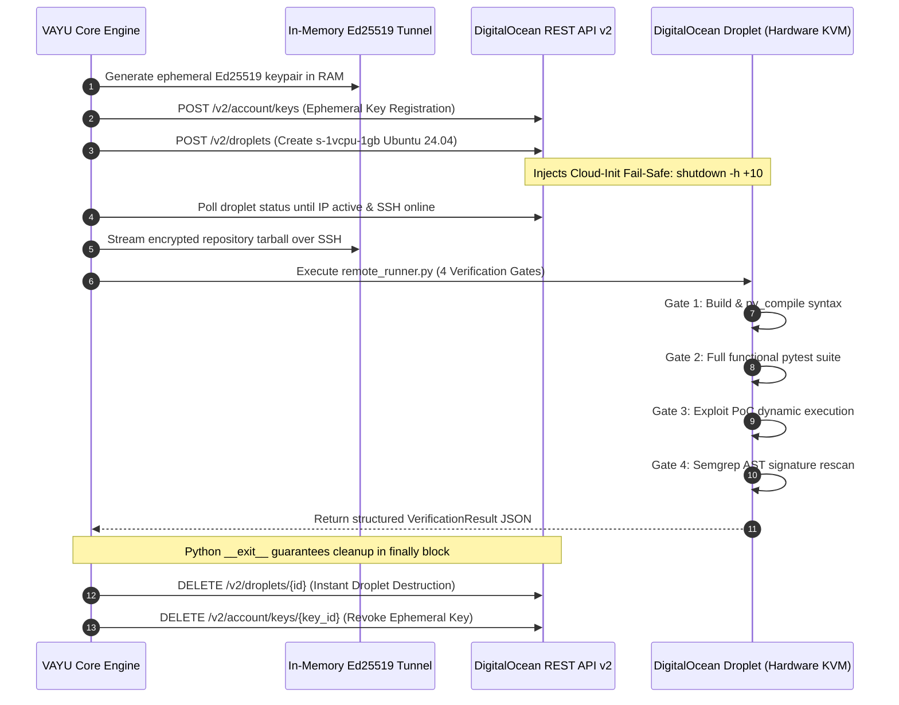

# ⚡ VAYU — Autonomous Cyber Reasoning System (CRS)

<p align="center">
  
  
  
  
  
</p>

<p align="center">
  <a href="https://youtu.be/crQhPqTmjKI"></a>
  <a href="https://github.com/ayushkumar2601"></a>
  <a href="#-the-vayu-continuous-security-loop"></a>
  <a href="#-quickstart--installation"></a>
  <a href="#-vayu-web-review-console--direct-github-push"></a>
  <a href="#-comprehensive-documentation-suite"></a>
  <a href="#-security-invariants"></a>
  <a href="#-license"></a>
</p>

<p align="center">
  
</p>

---

## 📚 Comprehensive Documentation Suite

| Document | Purpose & Key Topics | Link |
|---|---|:---:|
| **⚡ Master Technical Documentation** | Complete, monolithic technical specification: architecture, algorithms, data contracts, STRIDE threat models, and operational runbooks. | **[TECHNICAL_DOCUMENTATION.md](TECHNICAL_DOCUMENTATION.md)** |
| **📖 Documentation Hub** | Central documentation portal and index linking all sub-guides. | **[docs/README.md](docs/README.md)** |
| **🏛️ System Architecture Specification** | Deep architectural breakdown, 7-layer topology, finding state machine, and DARPA AIxCC design principles. | **[ARCHITECTURE.md](ARCHITECTURE.md)** |
| **🛡️ Formal Security Invariants** | Formal mathematical safety proofs, fail-closed guarantees, and zero-trust LLM boundary definitions. | **[DESIGN.md](DESIGN.md)** |
| **☁️ Verification & Cloud Sandboxing** | Dual-mode verification: local `/tmp` sandboxes vs. **DigitalOcean KVM Droplets** with RAM-only Ed25519 tunnels and 10m TTL kill switch. | **[docs/cloud-and-local-sandboxing.md](docs/cloud-and-local-sandboxing.md)** |
| **💻 CLI & Operational Reference** | Complete reference for `vayu`, `vayu scan`, `vayu skills`, `vayu-mcp`, arguments, flags, and exit codes. | **[docs/cli-reference.md](docs/cli-reference.md)** |
| **🔌 Model Context Protocol (MCP) Server** | Architecture and API specification for the 9 core MCP tools running over standard `stdio`. | **[docs/mcp-server.md](docs/mcp-server.md)** |
| **🖥️ MCP Client Configuration Guide** | Complete setup guide for Claude Desktop, Cursor, Windsurf, Claude Code, and Goose. | **[docs/mcp-clients.md](docs/mcp-clients.md)** |
| **🔒 MCP Security & Boundary Defense** | Filesystem containment, session isolation, and access control policies for MCP. | **[docs/mcp-security.md](docs/mcp-security.md)** |
| **🧠 Agent Skills Ecosystem** | Architecture of the Agent Skills framework, bundled catalog of 8 skills, and `vayu skills` CLI workflows. | **[docs/skills-ecosystem.md](docs/skills-ecosystem.md)** |
| **🌐 Web Dashboard & Review Console** | Next.js 16 Web Dashboard, NDJSON streaming wire protocol (`crs.stream`), 3D WebGL terrain, and direct GitHub commit/PR push. | **[docs/web-review-console.md](docs/web-review-console.md)** |
| **🔐 Cryptographic Provenance & SARIF** | in-toto SLSA v1.0 attestations, ECDSA (P-256) digital signatures, and OASIS SARIF v2.1.0 reporting. | **[docs/slsa-and-sarif.md](docs/slsa-and-sarif.md)** |
| **📚 Python API & Data Contracts** | Comprehensive Python API reference for all classes, methods, and Pydantic schemas. | **[docs/api-reference.md](docs/api-reference.md)** |
| **🎬 Presentation & Live Demo Guide** | Word-for-word presentation script, terminal matrix, and judge Q&A defense playbook. | **[DEMO_GUIDE.md](DEMO_GUIDE.md)** |

---

## 📌 Executive Overview

**VAYU** is a next-generation **Autonomous Cyber Reasoning System (CRS)** inspired by the DARPA AI Cyber Challenge (AIxCC). Traditional security scanners inundate engineering teams with hundreds of false-positive static warnings and leave triage, exploit analysis, code remediation, and validation to overloaded developers.

VAYU inverts this model through an autonomous, deterministic, and fail-closed cyber reasoning loop:

$$\textbf{FIND} \longrightarrow \textbf{REASON} \longrightarrow \textbf{PATCH} \longrightarrow \textbf{VERIFY} \longrightarrow \textbf{DEPLOY}$$

Unlike naive LLM code-generation scripts that hallucinate broken diffs, VAYU adheres to strict mathematical safety invariants:
1. **The LLM never generates code directly**: The model outputs constrained, atomic structured edit intent (`PatchEdit`).
2. **Deterministic diff synthesis**: Unified diffs are constructed by trusted Python AST algorithms outside the model boundary.
3. **4-Gate fail-closed verification**: No patch is ever accepted or presented without Passing Syntax, Functional Regression, Exploit Eradication, and AST Rescan.
4. **Isolated execution**: Verification runs either in ephemeral local sandboxes or in **disposable DigitalOcean Cloud KVM Droplets**, guaranteeing that the original target repository remains **100% untouched** (byte-for-byte SHA-256 fingerprint verified).

---

## ☁️ DigitalOcean Ephemeral Cloud Sandboxing

> [!IMPORTANT]
> **Why Cloud Sandboxing Matters in Cyber Reasoning**:
> When testing real-world vulnerability remediations (e.g., Remote Code Execution via `subprocess`, OS Command Injection, deserialization attacks, memory corruption, path traversal), executing proof-of-concept exploits locally on developer machines or inside shared CI runners is **fundamentally unsafe**. A malicious or weaponized repository could escape container boundaries, poison local caches, or compromise host infrastructure.

VAYU solves this with native **DigitalOcean Ephemeral Droplet Sandboxing** (`--sandbox digitalocean`):



### DigitalOcean Engineering Highlights

| Feature | Technical Implementation | Benefit |
|---|---|---|
| **Zero-Footprint REST Client** | [`crs/verification/cloud/do_client.py`](crs/verification/cloud/do_client.py) written purely with Python standard library `urllib.request`. | Zero bloated third-party cloud SDKs or heavy external dependencies. |
| **In-Memory Cryptography** | [`crs/verification/cloud/ssh_tunnel.py`](crs/verification/cloud/ssh_tunnel.py) generates Ed25519 keypairs strictly in RAM. | Private keys never touch host disk blocks, preventing credential leakage. |
| **Hardware-Isolated KVM** | DigitalOcean `s-1vcpu-1gb` standard droplets (Ubuntu 24.04 LTS x64) provisioned in ~45 seconds. | Kernel-level hardware hypervisor boundary shields developer systems from malicious exploits. |
| **Cloud-Init Safety TTL Failsafe** | Cloud-init injects `echo "shutdown -h +10 'VAYU Safety TTL'" \| at now` on first boot. | If local network drops or host loses power, DigitalOcean automatically self-destructs the instance after 10m. |
| **Micro-Billing Cost Model** | Droplets exist only for the ~60-90 second verification duration. | DigitalOcean per-second billing results in **~$0.0007 per full verification run** (< 0.1¢ per audit). |
| **Fail-Closed Guarantee** | If cloud provisioning times out or encounters API limits, verification immediately returns `approved=False`. | Untrusted patches can **never** be auto-approved without verifiable 4-gate proof. |

---

## 🔬 The VAYU Continuous Security Loop

```text
 ┌────────────────────────────────────────────────────────────────────────┐
 │                     THE VAYU 4-STAGE REASONING PIPELINE                 │
 └────────────────────────────────────────────────────────────────────────┘
          │
          ▼
   ┌──────────────┐      Extract AST nodes, CWE classification,
   │   1. FIND    │ ───► code fingerprints, and precise source span
   └──────────────┘      via Semgrep AST engine.
          │
          ▼
   ┌──────────────┐      Local offline rule synthesis or LLM reasoning
   │  2. REASON   │ ───► (Ollama / Gemma 4 / Qwen) producing atomic
   └──────────────┘      PatchEdit (old_text -> new_text) intent.
          │
          ▼
   ┌──────────────┐      Trusted Python engine computes unified diff;
   │   3. PATCH   │ ───► rejects non-contiguous multi-hunks, verifies
   └──────────────┘      fingerprints, and constructs patch archive.
          │
          ▼
   ┌──────────────┐      Executes in DigitalOcean Droplet or local /tmp:
   │  4. VERIFY   │ ───► Gate 1: Build & Syntax (py_compile)
   └──────────────┘      Gate 2: Functional Regression (pytest)
          │              Gate 3: Exploit Regression (Dynamic PoC)
          │              Gate 4: Semgrep AST Rescan (Zero findings)
          ▼
   ┌──────────────┐
   │ 5. DECISION  │ ───► VERIFIED  -> ECDSA Signed SLSA Attestation
   └──────────────┘      REJECTED  -> Fail-closed drop, Zero mutation
```

<p align="center">
  
</p>

### The 4 Formal Verification Gates

1. **Gate 1: Build & Syntax Integration**  
   Verifies that the target file parses cleanly into an Abstract Syntax Tree (AST) using language-specific compilers (`py_compile` / `tsc`). Rejects syntax errors, unbalanced brackets, or broken indentation.
2. **Gate 2: Functional Regression Suite**  
   Runs the target project's entire existing unit and integration test suite (`pytest`, `npm test`, etc.). If the patch breaks existing business logic or features, it is rejected immediately.
3. **Gate 3: Exploit Regression Testing**  
   Synthesizes and executes a dynamic proof-of-concept exploit against the patched code. The test must prove that dangerous operations (e.g., shell command execution, SQL injection payload execution) are eliminated.
4. **Gate 4: Static AST Rescan**  
   Runs Semgrep against the patched workspace using the exact security rule that caught the vulnerability. If the signature triggers even once, the patch is rejected.

<p align="center">
  
</p>

---

## 🖥️ VAYU Web Review Console & Direct GitHub Push

VAYU includes an enterprise-grade, high-performance web interface built with **Next.js 16 (Turbopack)** and a sleek Linear/GitHub security review design aesthetic (`/reviews`):

<p align="center">
  
</p>

### Key Web Console Features

- **Segmented Sandbox Toggle**: Switch between `☁ DigitalOcean` hardware hypervisor Droplets and `💻 Local /tmp` with one click.
- **Verification & Proof Telemetry Card**: Visualizes the active DigitalOcean Droplet instance (`s-1vcpu-1gb`), datacenter region (`NYC3`), Ed25519 in-memory tunnel, and `INV-DO-2` auto-teardown safety guarantee.
- **🐙 One-Click Push to GitHub**: Integrates with [`POST /api/git/push`](vayu-nextjs/app/api/git/push/route.ts) to automatically stage, commit verified security patches with rich metadata, and push directly to `origin/main`.
- **Keyboard-Driven Shortcuts**: Navigate reviews with `J`/`K`, toggle tabs with `1`-`5`, trigger runs with `R`, and push code with `P`.

<p align="center">
  
</p>

---

## 🌐 3D Threat Terrain Mission Control (`/dashboard`)

For security operations centers and architectural oversight, VAYU includes an interactive **3D WebGL point-cloud codebase elevation map**:

<p align="center">
  
</p>

- **Topological Elevation Map**: File density and nesting complexity rise into visual highlands.
- **Vulnerability Hot-Zones**: Glowing orange peaks identify vulnerable endpoints (e.g. `app.py`).
- **Real-Time Thermal Cooling**: As VAYU generates and verifies the remediation patch in the background, the glowing orange hotspot cools to stable green/blue.
- **System Architecture Simulation**: Switch to "System View" to simulate data flow from untrusted client inputs through web routes and into database/system shells.

---

## 🧰 VAYU Skills CLI Engine

Inspired by Anthropic's developer experience, VAYU includes a dedicated **Skills CLI** (`vayu skills`) with an animated terminal installer, dependency management, and health diagnostics:

<p align="center">
  
</p>

```bash
# Browse bundled skills catalog
vayu skills list

# Install security analysis skill into project repository (.agents/skills/)
vayu skills add security-analysis

# Install skill globally for user-level AI coding agents
vayu skills add vulnerability-remediation --global

# Install external skills directly from GitHub
vayu skills add frontend-design --from https://github.com/anthropics/skills

# Run comprehensive system diagnostics
vayu skills doctor
```

### Bundled Skills Catalog

| Skill Name | Purpose |
|---|---|
| `security-analysis` | Vulnerability triage, scanner evidence interpretation, and root-cause mapping |
| `secure-code-review` | Code auditing for OWASP Top 10, taint flows, and unsafe primitives |
| `vulnerability-remediation` | Minimal, bounded security patching without architectural refactoring |
| `patch-verification` | 4-stage fail-closed verification (syntax, tests, exploit regression, rescan) |
| `prompt-injection-defense` | Untrusted repository separation, boundary tagging, and prompt firewalls |
| `sast-workflow` | Semgrep AST pattern matching, custom rule authoring, and evidence building |
| `mcp-development` | Model Context Protocol tool authoring, schema binding, and stdio safety |
| `vayu-development` | VAYU system architecture, Pydantic data models, and safety invariants |

---

## 🔌 Model Context Protocol (MCP) Server

VAYU implements an enterprise **FastMCP Protocol Server** ([`crs/mcp/server.py`](crs/mcp/server.py)), enabling AI-assisted developer environments (Claude Desktop, Cursor, Antigravity IDE, Zed) to natively invoke VAYU's cyber reasoning capabilities:

```json
{
  "tools": [
    {
      "name": "vayu_scan_repo",
      "description": "Performs Semgrep AST vulnerability scan with SHA-256 fingerprinting"
    },
    {
      "name": "vayu_remediate_finding",
      "description": "Synthesizes minimal, bounded security patch for a specific finding"
    },
    {
      "name": "vayu_verify_patch",
      "description": "Executes 4-gate verification in DigitalOcean Droplet or local sandbox"
    },
    {
      "name": "vayu_run_pipeline",
      "description": "Runs complete Find -> Reason -> Patch -> Verify loop autonomously"
    },
    {
      "name": "vayu_audit_trail",
      "description": "Inspects cryptographic SLSA provenance attestation and audit logs"
    }
  ]
}
```

### Adding VAYU to Claude Desktop / Cursor

Add to your `claude_desktop_config.json` or Cursor MCP settings:

```json
{
  "mcpServers": {
    "vayu": {
      "command": "/absolute/path/to/vayu/venv/bin/vayu-mcp",
      "args": ["--stdio"],
      "env": {
        "DIGITALOCEAN_TOKEN": "dop_v1_your_token_here",
        "AIKAVACH_LLM_PROVIDER": "auto"
      }
    }
  }
}
```

---

## 🚀 Quickstart & Installation

### Prerequisites
- **Python 3.11+**
- **Node.js 18+** & `npm`
- **Semgrep CLI** (automatically bundled in `requirements.txt`)
- *(Optional for Cloud Sandbox)* **DigitalOcean Personal Access Token**
- *(Optional for Local AI)* **Ollama** (`qwen2.5-coder:3b` or `llama3`)

### 1. Clone & Setup Python Environment

```bash
git clone https://github.com/ayushkumar2601/vayu_hacktoberfest.git
cd vayu_hacktoberfest

python3 -m venv venv
source venv/bin/activate
pip install --upgrade pip
pip install -r requirements.txt
pip install -e .
```

### 2. Configure Environment Variables

Create a `.env` file in the project root:

```ini
# DigitalOcean Ephemeral Cloud Sandboxing
DIGITALOCEAN_TOKEN=dop_v1_your_api_token_here
DO_REGION=nyc3
DO_DROPLET_SIZE=s-1vcpu-1gb

# Optional: Local Ollama Model
AIKAVACH_LLM_PROVIDER=auto
AIKAVACH_OLLAMA_URL=http://127.0.0.1:11434
AIKAVACH_OLLAMA_MODEL=qwen2.5-coder:3b
```

### 3. Run Test Suite (188 Tests)

```bash
venv/bin/python -m pytest -q
# Output: 188 passed in 17.30s
```

### 4. Launch the Web Review Console

```bash
cd vayu-nextjs
npm install
npm run dev
# Open http://localhost:3000/reviews in your browser
```

---

## 💻 CLI Usage Examples

### Run Vulnerability Scan with Local Ephemeral Sandbox
```bash
vayu scan samples/vulnerable/command_injection --sandbox local
```

### Run Vulnerability Scan with DigitalOcean Cloud Sandbox
```bash
vayu scan samples/vulnerable/command_injection --sandbox digitalocean
```

---

## 🛡️ Security Invariants & Guarantees

```text
┌────────────────────────────────────────────────────────────────────────┐
│                      VAYU MATHEMATICAL SAFETY INVARIANTS               │
├────────────────────────────────────────────────────────────────────────┤
│ INV-1: Original Repository Byte-Identical Preservation                 │
│        Target directory SHA-256 hash is identical before and after.    │
├────────────────────────────────────────────────────────────────────────┤
│ INV-2: Fail-Closed Verification Enforcement                            │
│        If any gate fails or errors, final status is REJECTED.          │
├────────────────────────────────────────────────────────────────────────┤
│ INV-3: Out-of-Band Diff Construction                                   │
│        The LLM cannot generate raw diff strings; only atomic intents.  │
├────────────────────────────────────────────────────────────────────────┤
│ INV-4: Ephemeral Droplet Teardown Invariant                            │
│        DigitalOcean droplets are destroyed in finally blocks on exit.  │
├────────────────────────────────────────────────────────────────────────┤
│ INV-5: Cloud-Init Auto-Shutdown Failsafe                               │
│        Cloud instances terminate via shutdown -h +10 independently.    │
└────────────────────────────────────────────────────────────────────────┘
```

---

## 🏆 Hackathon & Award Winning Highlights

1. **True Autonomous Remediation**: Not another prompt wrapper or static linter. VAYU is a complete **Cyber Reasoning System** that finds vulnerabilities, reasons about their root cause, synthesizes verifiable fixes, and mathematically proves their correctness.
2. **First-Class DigitalOcean Integration**: Demonstrates state-of-the-art use of DigitalOcean's infrastructure—spinning up ephemeral cloud hypervisors on-demand for zero-trust sandbox execution, and tearing them down within seconds.
3. **Enterprise Defense in Depth**: Cryptographic SLSA Provenance generation signed via ECDSA curves, protecting open-source software supply chains from supply-chain contamination.
4. **Developer Experience Excellence**: From the interactive Three.js 3D threat terrain to the Linear-inspired reviews triage dashboard and Anthropic-inspired Skills CLI, every single screen is meticulously designed for high-velocity security workflows.

---

## 👤 Author

Made with ❤️ by **[Ayush Kumar](https://github.com/ayushkumar2601)**

---

## 📄 License

VAYU is released under the **Apache 2.0 License**. See [LICENSE](LICENSE) for details.

---

<p align="center">
  <sub>Made with ❤️ by <a href="https://github.com/ayushkumar2601">Ayush Kumar</a> • Built with pride for Hacktoberfest & modern application security teams worldwide.</sub><br/>
  <b>VAYU — The Autonomous Cyber Reasoning System.</b>
</p>
