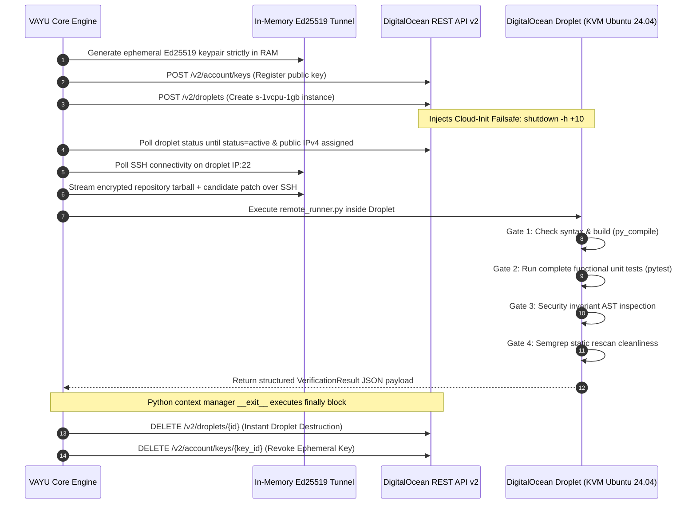
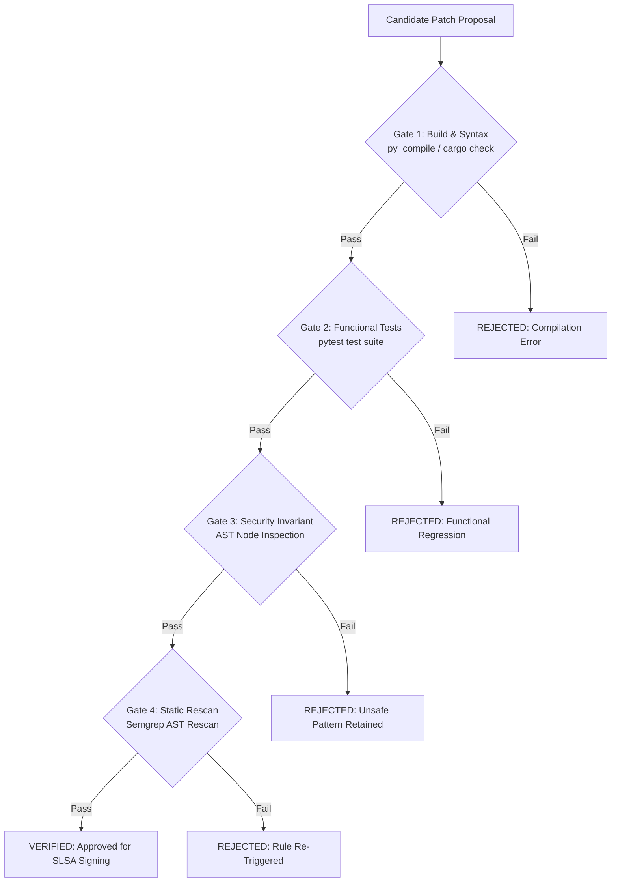

# ☁️ VAYU Verification & Ephemeral Cloud Sandboxing

Verification is the cornerstone of autonomous cyber reasoning. When an automated system attempts to remediate real-world vulnerabilities (e.g., Remote Code Execution via `subprocess`, OS Command Injection, arbitrary file disclosure, or insecure deserialization), executing candidate patches and dynamic proof-of-concept exploits locally on developer machines or inside shared CI runners is **fundamentally unsafe**.

A hostile or weaponized repository could escape container boundaries, modify parent directories, exfiltrate host environment variables, or compromise host infrastructure.

VAYU implements a **Dual-Mode 4-Gate Fail-Closed Verification Engine** supporting both:
1. **Local Ephemeral Workspace Sandboxing** (`--sandbox local`)
2. **DigitalOcean Ephemeral Cloud Droplet Sandboxing** (`--sandbox digitalocean`) with hardware KVM isolation.

---

## 1. Architectural Comparison: Local vs. Cloud Sandbox

| Evaluation Dimension | Local Ephemeral Workspace (`local`) | DigitalOcean Cloud Droplet (`digitalocean`) |
|---|---|---|
| **Isolation Boundary** | OS filesystem directory separation (`/tmp/vayu-verify-XXXXXX`) | Full Hardware-Level KVM Hypervisor (Ubuntu 24.04 LTS x64) |
| **Execution Host** | Developer workstation / Local host kernel | Dedicated, remote, disposable Cloud Droplet (`s-1vcpu-1gb`) |
| **Host Escape Defense** | Medium (Process permissions boundary) | Maximum (Kernel hypervisor boundary, no host network access) |
| **Private Key Security** | N/A (Local execution) | In-Memory Ed25519 keypair in RAM (zero disk persistence) |
| **Emergency Failsafe** | Python `finally:` block unlinks `/tmp` tree | Cloud-Init auto-shutdown kill switch (`shutdown -h +10`) |
| **Provisioning Overhead** | Instant ($\approx 15 - 50\text{ ms}$) | $\approx 45 - 60\text{ seconds}$ (DigitalOcean API provisioning) |
| **Network Cost** | Zero (100% offline air-gapped) | Negligible ($\approx 100\text{ KB}$ encrypted SSH stream) |
| **Financial Cost** | $0.00 | $\approx \$0.0007$ per verification run (< 0.1¢ per audit) |
| **Recommended Use** | Local development, unit testing, air-gapped CI | Production audits, untrusted third-party code, live PoC exploits |

---

## 2. DigitalOcean Ephemeral Cloud Sandboxing Deep Dive

### 2.1 Complete Lifecycle Sequence



### 2.2 In-Memory Cryptographic Tunnel (`ssh_tunnel.py`)

To prevent private key leakage:
1. `SSHTunnel` generates an Ed25519 elliptic-curve keypair dynamically inside host process RAM using Python's `cryptography` library.
2. The private key is serialized directly into a memory buffer and passed to the SSH subprocess via standard input (`stdin`) or memory pipes.
3. Private key bytes **never touch host disk storage**, preventing credential forensic extraction or leakage in temporary files.

### 2.3 Cloud-Init Safety TTL Failsafe (Anti-Zombie Instance Guarantee)

A critical hazard in cloud automation is network interruption: if the developer's laptop loses Wi-Fi or crashes during an audit, orphaned cloud instances could continue running indefinitely and accumulate billing charges.

VAYU eliminates this hazard via a **Cloud-Init Safety TTL Kill Switch**:
```yaml
#cloud-config
runcmd:
  - echo "shutdown -h +10 'VAYU Safety TTL Expired'" | at now
```
On instance boot, the Linux `at` daemon schedules an unconditional machine halt and poweroff 10 minutes in the future. Even if the VAYU client process is abruptly killed with `kill -9`, DigitalOcean automatically terminates the Droplet.

### 2.4 Zero-Dependency REST API v2 Client (`do_client.py`)

Rather than forcing the installation of bloated third-party cloud SDKs (e.g., `boto3`, `google-cloud`, or multi-megabyte DO wrappers), VAYU's `DigitalOceanClient` is written purely with Python's standard library `urllib.request`.

- Zero external dependencies.
- Strict HTTP status code and error body classification.
- Idempotent resource cleanup (404 on `DELETE` is treated as a successful deletion).

---

## 3. The 4 Fail-Closed Verification Gates

Every candidate patch must survive four sequential, deterministic gates. A failure at any gate halts execution, rejects the patch, and triggers the self-correction loop.



### Gate 1: Build & Syntax AST Compilation Check
- **Purpose**: Verifies that the proposed edit did not introduce syntax errors, unexpected indentation, or compilation breaks.
- **Python Implementation**: `python -m py_compile <affected_file>`
- **Polyglot Extensibility**: Supports `cargo check` (Rust), `go build -o /dev/null` (Go), `npm run build` (Node.js).

### Gate 2: Functional Unit Test Suite
- **Purpose**: Verifies that business logic invariants are preserved and no regressions were introduced.
- **Implementation**: Runs `pytest tests/` (or repository native test runner).
- **Rule**: If any existing unit test fails, the patch is rejected immediately.

### Gate 3: Security Invariant AST Inspection
- **Purpose**: Inspects the patched code's Abstract Syntax Tree using Python's `ast` module to verify that the dangerous construct has been structurally removed:
  - **CWE-78**: Confirms no `subprocess.run/Popen/check_output` invocation retains `shell=True`.
  - **CWE-502**: Confirms `pickle.loads` has been replaced with safe deserialization (`json.loads`).
  - **CWE-328**: Confirms `hashlib.md5` has been upgraded to `hashlib.sha256`.
  - **CWE-798**: Confirms hardcoded secrets are replaced with `os.getenv`.

### Gate 4: Semgrep Static AST Rescan Cleanliness
- **Purpose**: Re-executes the complete Semgrep rule engine over the patched workspace.
- **Rule**: If the original finding's Semgrep rule ID triggers on the patched file, remediation is considered incomplete and the patch is rejected.

---

## 4. Configuration & Operational Runbook

### Environment Variables
Configure DigitalOcean credentials in `.env.local`:
```bash
# DigitalOcean API Personal Access Token (Read & Write permissions)
export DIGITALOCEAN_TOKEN=dop_v1_your_token_here

# Datacenter Region (default: nyc3)
export DO_REGION=nyc3

# Droplet Hardware Size (default: s-1vcpu-1gb, $0.0089/hr = ~$0.0007/run)
export DO_SIZE=s-1vcpu-1gb

# Operating System Image (default: ubuntu-24-04-x64)
export DO_IMAGE=ubuntu-24-04-x64

# Total Timeout for Droplet Lifecycle in seconds (default: 300.0)
export DO_SANDBOX_TIMEOUT=300.0

# Safety TTL in minutes before cloud-init auto-shutdown (default: 10)
export DO_SAFETY_TTL_MINUTES=10
```

### Executing a Cloud-Sandboxed Scan
```bash
source venv/bin/activate
source .env.local

python -m crs.vayu scan samples/vulnerable/command_injection --sandbox digitalocean
```

---

*VAYU Ephemeral Cloud Sandboxing guarantees that developer hosts remain 100% untouched and protected by hardware-isolated hypervisors.*
